 Link YT
 https://www.youtube.com/shorts/qHi9S-_k9cI
# BÁO CÁO TÍNH NĂNG & HƯỚNG DẪN HỆ THỐNG ĐIỂM DANH SINH VIÊN

* **Sinh viên thực hiện:** Từ Minh Hiển
* **Mã số sinh viên (MSSV):** 20260630
* **Môn học:** Lập trình di động (LTDD) - Giảng viên phụ trách: Thầy Hùng
* **Dự án App Mobile:** `0630_TuMinhHien_App` (Flutter / Dart)
* **Dự án Backend API:** `0630_TuMinhHien_WebAPI` (ASP.NET Core 8.0, EF Core, SQL Server)
* **Cơ sở dữ liệu:** SQL Server `.\SQLEXPRESS` $\rightarrow$ Database: `0630_TuMinhHien_WebAPI`

---

## 1. KIẾN TRÚC TỔNG THỂ HỆ THỐNG

```mermaid
flowchart TD
    subgraph Client ["Ứng dụng Di động (Flutter App)"]
        UI["Giao diện Người dùng (Material Design 3 - Dark Theme)"]
        Auth["Xác thực JWT / SharedPreferences / Auto-Login"]
        FaceMod["Face Recognition / Camera / ML Kit"]
        GPSMod["GPS Geolocator (Haversine Formula)"]
        AIMOD["Fast AI Translator (Dịch Realtime / OCR)"]
    end

    subgraph Server ["Máy chủ Web API (ASP.NET Core 8.0)"]
        Swagger["Swagger UI Documentation (/swagger)"]
        AuthCtrl["AuthenticateController (Identity + OTP + Face)"]
        AttCtrl["AttendanceApiController (Điểm danh GPS)"]
        ClassCtrl["ClassroomApiController (Quản lý phòng học)"]
        ProdCtrl["ProductApiController (CRUD Sản phẩm)"]
        CatCtrl["CategoryApiController (CRUD Danh mục)"]
        MemoryCache["IMemoryCache (Lưu trữ OTP 10 phút)"]
    end

    subgraph Database ["Cơ sở dữ liệu (SQL Server)"]
        AspNetUsers["identity.AspNetUsers (Tài khoản, FaceData, MSSV)"]
        AspNetRoles["identity.AspNetRoles (Admin, Staff, User)"]
        Classrooms["identity.Classrooms (Tọa độ GPS, Bán kính)"]
        AttendanceRecords["identity.AttendanceRecords (Lịch sử điểm danh)"]
        Categories["identity.Categories (Danh mục sản phẩm)"]
        Products["identity.Products (Sản phẩm - OnDelete: SetNull)"]
    end

    UI --> Auth & FaceMod & GPSMod & AIMOD
    Auth --> AuthCtrl
    GPSMod --> AttCtrl
    FaceMod --> AttCtrl & AuthCtrl
    AuthCtrl --> MemoryCache & AspNetUsers & AspNetRoles
    AttCtrl --> AttendanceRecords & Classrooms
    ClassCtrl --> Classrooms
    ProdCtrl --> Products
    CatCtrl --> Categories
```

---

## 2. DANH SÁCH TÀI KHOẢN & PHÂN QUYỀN (ROLES)

Hệ thống được cấu hình sẵn 3 phân quyền chuẩn trong Database để phục vụ chấm bài và kiểm thử:

| Phân quyền (Role) | Tên đăng nhập | Mật khẩu | Quyền hạn chính |
| :--- | :--- | :--- | :--- |
| **Quản trị viên (Admin)** | `admin01` | `AdminPassword123!` | Toàn quyền cấu hình tọa độ GPS lớp học, chỉnh bán kính Geofencing, xem điểm danh toàn trường, CRUD Danh mục & Sản phẩm |
| **Giảng viên (Staff)** | `staff01` | `StaffPassword123!` | Chọn xem danh sách điểm danh theo từng môn học/lớp học, theo dõi khoảng cách mét thực tế, sửa trạng thái điểm danh và thêm ghi chú |
| **Sinh viên (User)** | `sinhvien01` *(hoặc MSSV `20260630`)* | `StudentPass123!` | Điểm danh GPS bằng tọa độ thực tế, quét khuôn mặt Face ID, xem lịch sử điểm danh, sử dụng bộ công cụ dịch thuật AI Realtime |

---

## 3. TOÀN BỘ TÍNH NĂNG VÀ CHỨC NĂNG CỦA ỨNG DỤNG

### A. Phân hệ Xác thực & Bảo mật (Authentication & Security)

1. **Đăng ký tài khoản bắt buộc mã OTP Email:**
   - Người dùng nhập Email hợp lệ và bấm **"Gửi OTP"**.
   - Server sinh mã OTP 6 chữ số lưu tạm trong bộ nhớ đệm `IMemoryCache` (hiệu lực 10 phút).
   - Chỉ khi nhập đúng mã OTP gửi về Email, tài khoản mới được tạo trong Database.
2. **Quên mật khẩu & Đặt lại mật khẩu bằng OTP:**
   - Tại màn hình Đăng nhập, bấm liên kết **"Quên mật khẩu?"**.
   - Hỗ trợ tìm kiếm tài khoản linh hoạt bằng Email, Tên đăng nhập hoặc MSSV.
   - Bấm **"Gửi OTP"** $\rightarrow$ Server xác minh danh tính và cấp mã OTP.
   - Nhập OTP và mật khẩu mới $\rightarrow$ Hệ thống tự động mã hóa và cập nhật mật khẩu mới qua ASP.NET Core Identity.
3. **Đăng nhập linh hoạt:**
   - Đăng nhập trực tiếp bằng Tên đăng nhập, Email hoặc MSSV (không bắt buộc OTP để thao tác nhanh).
   - Tùy chọn **"Xác thực OTP"** nếu người dùng muốn tăng cường bảo mật 2 lớp.
4. **Đăng nhập bằng nhận diện khuôn mặt (Face Login / Face ID):**
   - Đăng ký dữ liệu khuôn mặt một lần tại mục Cài đặt ⚙️ (`📸 Quét khuôn mặt tạo Face ID`).
   - Tại màn hình Đăng nhập, bấm nút **"ĐĂNG NHẬP BẰNG KHUÔN MẶT"** $\rightarrow$ Camera chụp ảnh khuôn mặt và tự động đối soát xác thực trên Server, không cần gõ mật khẩu.
5. **Tự động đăng nhập lại (Auto-login) nhớ chính xác phân quyền:**
   - Lưu trữ mã Token JWT và thông tin người dùng trong `SharedPreferences`.
   - Khi thoát app hoàn toàn và mở lại, hệ thống giải mã JWT (`JwtDecoder`), kiểm tra hạn token và **điều hướng trực tiếp vào đúng giao diện của quyền đó** (Admin vào AdminDashboard, Giảng viên vào StaffDashboard, Sinh viên vào StudentHomeScreen), khắc phục triệt để lỗi nhảy nhầm vào trang User.
6. **Đăng xuất an toàn:**
   - Nút Cài đặt (⚙️) ở góc phải trên cùng các màn hình có chức năng Đăng xuất, xóa toàn bộ Token và phiên làm việc khỏi bộ nhớ thiết bị.

---

### B. Phân hệ Điểm danh GPS & Tọa độ thực địa (Smart GPS Attendance)

1. **Định vị GPS tọa độ thực tế:**
   - Ứng dụng sử dụng gói `geolocator` lấy kinh độ (`longitude`) và vĩ độ (`latitude`) chính xác từ chip GPS thiết bị.
2. **Thuật toán tính khoảng cách Haversine Formula:**
   - Khi sinh viên bấm Điểm danh, Server tính toán khoảng cách thực tế giữa vị trí sinh viên và phòng học theo mặt cong trái đất:
     $$d = 2R \times \arcsin\left(\sqrt{\sin^2\left(\frac{\Delta\varphi}{2}\right) + \cos(\varphi_1)\cos(\varphi_2)\sin^2\left(\frac{\Delta\lambda}{2}\right)}\right)$$
3. **Tự động phân loại trạng thái Geofencing:**
   - Nếu $d \le \text{Bán kính phòng học}$ (ví dụ $\le 100\text{m}$): Trạng thái là **"Có mặt"**.
   - Nếu $d > \text{Bán kính phòng học}$: Trạng thái là **"Ngoài phạm vi"** và ghi rõ số mét chênh lệch trong hệ thống.
4. **Cấu hình vị trí lớp học linh hoạt cho Admin:**
   - Admin không bị cố định vị trí phòng học ở trường, có thể:
     - Bấm nút **"Lấy GPS hiện tại"** để biến phòng/vị trí đang đứng thành phòng học điểm danh.
     - Chọn nhanh các vị trí trường: HUTECH Khu E (Quận 9), HUTECH Cơ sở Ung Văn Khiêm, HUTECH Trụ sở Điện Biên Phủ, v.v.
     - Tùy chỉnh bán kính cho phép (50m, 100m, 200m...).

---

### C. Phân hệ Dành cho Giảng viên (Staff Dashboard)

1. **Theo dõi danh sách điểm danh theo thời gian thực:**
   - Giảng viên chọn môn học/lớp học từ menu Dropdown để tải toàn bộ danh sách sinh viên đã điểm danh.
2. **Bảng thống kê trực quan:**
   - Thống kê tức thì: **Tổng số**, **Có mặt**, **Ngoài GPS**, **Đi trễ**.
3. **Chỉnh sửa trạng thái điểm danh & Ghi chú của Giảng viên:**
   - Giảng viên có thể bấm vào từng sinh viên để chuyển đổi trạng thái: *Có mặt*, *Đi trễ*, *Vắng mặt*.
   - Cho phép nhập ghi chú giảng viên (Ví dụ: "Đến trễ 10 phút có xin phép").

---

### D. Phân hệ Công cụ Trí tuệ Nhân tạo Hỗ trợ Học tập (Fast AI Translator)

1. **Bộ dịch thuật thời gian thực siêu tốc (Realtime Text Translator):**
   - Ứng dụng kiến trúc Cache Model trong bộ nhớ RAM, giúp dịch văn bản song ngữ (Anh - Việt / Việt - Anh) ngay trong lúc gõ phím mà không bị giật lag.
2. **Nhận diện và dịch tài liệu bằng Camera (OCR Translation):**
   - Quét trang sách, giáo trình bằng camera di động $\rightarrow$ trích xuất chữ viết và dịch trực tiếp sang tiếng Việt.
3. **Hỗ trợ phát âm & Giọng nói:**
   - Tích hợp Text-to-Speech phát âm chuẩn từ vựng và Speech-to-Text nhận dạng giọng nói.

---

### E. Phân hệ Quản lý Danh mục & Sản phẩm (Bài tập Tuần 7 Thầy Hùng)

1. **Cấu trúc quan hệ 1-N (Category - Product):**
   - Mỗi Sản phẩm (`Product`) thuộc về một Danh mục (`Category`).
2. **Phân quyền CRUD:**
   - Người dùng đã đăng nhập có thể xem danh sách sản phẩm và danh mục.
   - Chỉ có tài khoản **Admin** mới có quyền Thêm, Sửa, Xóa Danh mục và Sản phẩm.
3. **Cơ chế Toàn vẹn Dữ liệu OnDelete(DeleteBehavior.SetNull):**
   - Khi Admin xóa một Danh mục, các Sản phẩm thuộc danh mục đó **không bị xóa mất**, mà trường `CategoryId` của sản phẩm sẽ tự động gán về `null`, đáp ứng chính xác 100% yêu cầu đề bài.

---

### F. Phân hệ Cài đặt Tiện ích & Kết nối Đa mạng (Settings Sheet)

1. **Nút Bánh răng cưa (⚙️) tích hợp:**
   - Xem thông tin tài khoản đang đăng nhập (Tên, MSSV, Role).
   - Nút **"📸 Quét khuôn mặt tạo Face ID"**.
   - Nút **"Đổi máy chủ / Cấu hình IP"**.
   - Nút **"Đăng xuất"**.
2. **Bộ chuyển đổi IP máy chủ nhanh (1 chạm):**
   - Hỗ trợ đổi nhanh giữa:
     - **Wi-Fi LAN:** `http://192.168.1.4:5276/api/` (Cho thiết bị cùng mạng Wi-Fi)
     - **Cáp USB (ADB Reverse):** `http://127.0.0.1:5276/api/` (Cho điện thoại cắm máy tính)
     - **Máy ảo Android Studio:** `http://10.0.2.2:5276/api/`
     - Ô nhập IP tùy biến khi mang máy đi nơi khác.
3. **Đèn báo trạng thái kết nối máy chủ:**
   - Đèn xanh: Máy chủ đang kết nối tốt.
   - Đèn đỏ: Mất kết nối, bấm vào để chọn lại IP.

---

## 4. BẢNG TỔNG HỢP TOÀN BỘ CÁC ĐẦU MÃ API (ENDPOINTS)

| Nhóm chức năng | Phương thức | Đường dẫn API (Endpoint) | Quyền hạn (Role) | Chức năng chi tiết |
| :--- | :---: | :--- | :---: | :--- |
| **Xác thực** | `POST` | `/api/Authenticate/register` | Công khai | Đăng ký tài khoản (kèm xác thực OTP) |
| **Xác thực** | `POST` | `/api/Authenticate/login` | Công khai | Đăng nhập hệ thống cấp JWT Token |
| **Xác thực** | `POST` | `/api/Authenticate/send-register-otp` | Công khai | Gửi mã OTP xác nhận Email khi đăng ký |
| **Xác thực** | `POST` | `/api/Authenticate/send-forgot-otp` | Công khai | Gửi mã OTP khôi phục mật khẩu |
| **Xác thực** | `POST` | `/api/Authenticate/reset-password-otp` | Công khai | Đặt lại mật khẩu mới bằng mã OTP |
| **Xác thực** | `POST` | `/api/Authenticate/enroll-face` | `Authorize` | Đăng ký dữ liệu khuôn mặt Face ID |
| **Xác thực** | `POST` | `/api/Authenticate/face-login` | Công khai | Đăng nhập bằng ảnh chụp khuôn mặt |
| **Điểm danh** | `POST` | `/api/AttendanceApi/check-in` | `Authorize` | Sinh viên gửi GPS & ảnh điểm danh |
| **Điểm danh** | `GET` | `/api/AttendanceApi/history/{mssv}` | `Authorize` | Xem lịch sử điểm danh của sinh viên |
| **Điểm danh** | `GET` | `/api/AttendanceApi/classroom/{id}` | `Admin, Staff` | Giảng viên xem điểm danh của lớp |
| **Điểm danh** | `PUT` | `/api/AttendanceApi/{id}/status` | `Admin, Staff` | Giảng viên cập nhật trạng thái & ghi chú |
| **Lớp học** | `GET` | `/api/ClassroomApi` | Công khai | Xem danh sách các môn học / phòng học |
| **Lớp học** | `POST` | `/api/ClassroomApi` | `Admin, Staff` | Thêm lớp học mới kèm tọa độ GPS |
| **Lớp học** | `PUT` | `/api/ClassroomApi/{id}` | `Admin` | Sửa thông tin phòng học, GPS, bán kính |
| **Lớp học** | `DELETE`| `/api/ClassroomApi/{id}` | `Admin` | Xóa phòng học khỏi hệ thống |
| **Sản phẩm** | `GET` | `/api/ProductApi` | `Authorize` | Xem danh sách sản phẩm |
| **Sản phẩm** | `POST` | `/api/ProductApi` | `Admin` | Thêm sản phẩm mới thuộc danh mục |
| **Sản phẩm** | `PUT` | `/api/ProductApi/{id}` | `Admin` | Cập nhật thông tin sản phẩm |
| **Sản phẩm** | `DELETE`| `/api/ProductApi/{id}` | `Admin` | Xóa sản phẩm |
| **Danh mục** | `GET` | `/api/CategoryApi` | Công khai | Xem danh sách danh mục sản phẩm |
| **Danh mục** | `POST` | `/api/CategoryApi` | `Admin` | Thêm danh mục mới |
| **Danh mục** | `PUT` | `/api/CategoryApi/{id}` | `Admin` | Cập nhật tên/mô tả danh mục |
| **Danh mục** | `DELETE`| `/api/CategoryApi/{id}` | `Admin` | Xóa danh mục (Sản phẩm về null) |

---

## 5. HƯỚNG DẪN DÀNH CHO GIÁO VIÊN & HỆ THỐNG AI CHẤM BÀI

### Bước 1: Kiểm tra kết nối Máy chủ Web API
1. Mở trình duyệt truy cập: [http://127.0.0.1:5276/swagger](http://127.0.0.1:5276/swagger) (hoặc qua LAN: [http://192.168.1.4:5276/swagger](http://192.168.1.4:5276/swagger)).
2. Trình duyệt hiển thị đầy đủ tài liệu API v1 có bản quyền của sinh viên Từ Minh Hiển.
3. Nếu máy chủ chưa bật, nhấp đúp vào file `CHAY_SERVER_WEBAPI.bat` trên Desktop máy tính để khởi động.

### Bước 2: Chấm bài trên App Mobile (Android / Flutter)
1. **Kiểm tra Đăng ký & OTP:**
   - Mở màn hình Đăng ký $\rightarrow$ nhập thông tin & email $\rightarrow$ bấm "Gửi OTP" $\rightarrow$ nhập OTP và bấm "ĐĂNG KÝ".
2. **Kiểm tra Quên mật khẩu & OTP:**
   - Tại màn hình Đăng nhập $\rightarrow$ bấm "Quên mật khẩu?" $\rightarrow$ nhập email/MSSV $\rightarrow$ bấm "Gửi OTP" $\rightarrow$ nhập OTP & mật khẩu mới $\rightarrow$ đổi mật khẩu thành công.
3. **Kiểm tra Phân quyền Đăng nhập (3 Vai trò):**
   - Đăng nhập `admin01` $\rightarrow$ vào màn hình Quản trị Admin.
   - Đăng nhập `staff01` $\rightarrow$ vào màn hình Giảng viên theo dõi điểm danh.
   - Đăng nhập `sinhvien01` $\rightarrow$ vào màn hình Sinh viên điểm danh GPS.
4. **Kiểm tra Auto-login & Đăng xuất:**
   - Đóng hoàn toàn app rồi mở lại $\rightarrow$ app tự động vào lại đúng giao diện của vai trò trước đó.
   - Bấm nút bánh răng (⚙️) $\rightarrow$ bấm "Đăng xuất" $\rightarrow$ app xóa token và quay về màn hình Đăng nhập.
5. **Kiểm tra Điểm danh GPS & Dịch thuật:**
   - Chọn môn học $\rightarrow$ bấm "Điểm danh ngay" $\rightarrow$ app tự động chụp ảnh khuôn mặt, đo khoảng cách GPS Haversine và xác nhận trạng thái.
   - Mở công cụ Dịch thuật $\rightarrow$ gõ văn bản hoặc mở camera quét chữ để kiểm tra AI Fast Translator.
